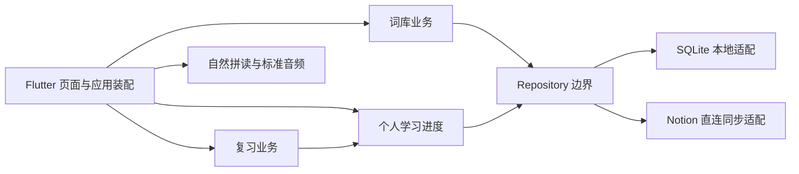

# 模块边界

P1-C 在本地词库、复习和 P1-B 发音能力上增加 Notion → SQLite 只读同步。首页、设置、主题及路由错误页沿用 Starter。Windows 为主学习端，Android 为移动复习端；Android 已有 Keystore 安全凭据和共享读取逻辑，真实手机同步因网络错误／超时仍待验收。当前状态见 [开发接续](DEVICE_HANDOFF.md) 和 [平台约定](PLATFORM_SCOPE.md)。下表保留 P0 起点，当前实现见模块 README 与阶段设计。

| 目录 | 职责 | P0 状态 |
|---|---|---|
| app、features/home、features/settings | 装配、路由、主题、最小壳 | 已实现并沿用 Starter |
| ui | 通用加载/空/错误/确认组件 | 保留 |
| core/config、logging、error、network、settings | 配置校验、日志、错误、HTTP、非敏感设置 | 保留，去除示例专属配置 |
| features/vocabulary | 内容/分类/来源及官方归属 | 预留 |
| features/review | 纯 Dart 复习规则 | 预留 |
| features/learning_progress | 个人状态与学习事件 | 预留 |
| features/pronunciation | 自然拼读和标准音频 | 预留 |
| core/storage | SQLite 迁移、事务、适配器 | 预留 |
| integrations/notion | Notion API 与同步映射 | 预留 |

共享业务不依赖平台 API，平台差异限制在数据/资源适配层。首次添加 SQLite、音频或系统凭据插件前分别核验 Windows/Android 支持，避免仅移动端可用的依赖。

Notion 拥有云端词条内容；本轮学习记录先独立保存在 SQLite，不自动回写。词库同步只更新内容及源页面映射，原有词义和发音事件保留，网络失败不丢本地结果。不实现双向冲突框架。Windows 凭据管理器通过一个原生适配边界承载密钥，平台无关业务仍共用。

保留既有稳定 ID 与两个独立 PETS 年份归属；缺少官方证据时 2025 待核实。新语言/考试作为数据维度，未来扩展 PETS-4 与日语无需替换整个项目结构。
