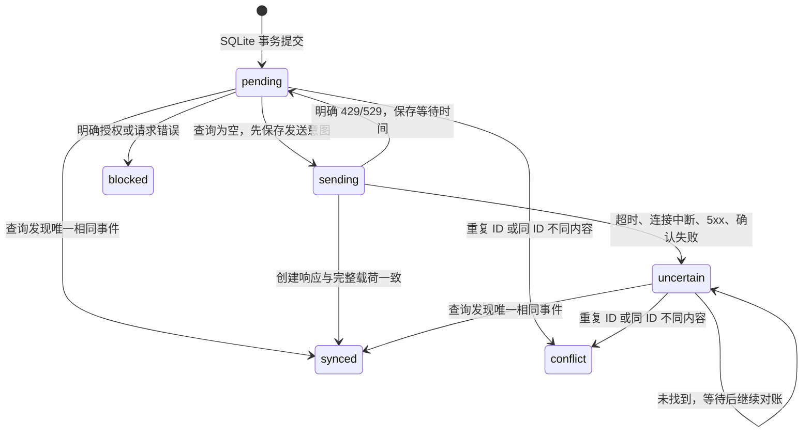

# P2-A 模拟学习事件同步设计

范围：Windows，现有 Flutter/HTTP/SQLite/WinCred，0.4.0+6。仅模拟事件，未把真实评分按钮接到上传队列。正式词库的 100 词、稳定词条 ID、词义/发音评级及复习日期沿用 P1-D，未迁移个人库。

## 存储与身份

P2-A 使用同一应用支持目录下的独立 SQLite 文件 `english_learning_p2a_simulation.sqlite3`，有自己的 schema v1。`EventStore` 打开时核对数据库版本和表名，遇到个人词库 schema v3 或未知表立即拒绝，不删除或重建。主学习库 `english_learning_v1.sqlite3` 保持 schema v3。

| 表 | 内容 |
|---|---|
| simulation_events | event_id 主键、word_id、learning_type、grade、occurred_utc、规范 payload_json、payload_hash、唯一 device_sequence |
| event_outbox | event_id 外键、state、next_attempt_utc、attempts、remote_page_id、last_error_code |
| event_sync_control | 整个队列的 deferred_until_utc，持久化 API 限流等待时间 |

先用一个短 SQLite 事务同时保存事件和 outbox；网络请求在事务外。上传失败只更新队列元数据，不改事件载荷。个人表不在这份数据库中，事件模块不持有个人库写接口。

模拟批次 `P2A-20261108-v1`，12 个现有稳定词条 ID，每词各一条词义与发音事件，共 24 条。每类 12 条，三种评级各 4 条。词义值保留 mastered/familiar/forgotten；发音保留 needsPractice/familiar/confident。事件明确包含 simulated=true、固定模拟设备、模拟时间、schema_version 和 algorithm_version=simulation-v1，不代表用户的学习经历。

事件 ID 使用 `sim-` 加批次/模拟设备/序号 SHA-256 的前 128 位。此处是可复现且固定的模拟身份，数据库主键/序号约束防止重复；同 ID 不同载荷拒绝并回滚，不覆盖。重启、重复生成、重复上传都沿用保存的 ID。P2-B 应改用设备身份与持久序号/随机 UUID 创建真实事件身份，仍沿用原词条 ID；不能把本模拟时间和 ID 规则用于推断真实学习历史。

## 独立 Notion 目标及权限

[P2-A 隔离测试库](https://www.notion.so/6a82ee8fd5814a0cbca5f00395bee8ea)，data source `3bf5dab6-53fc-4ba8-bcf4-cec0be0addd8`。

Event ID 为 Title；Word ID/Grade/Device ID/Algorithm Version/Payload Hash/Test Batch 为文本；Learning Type 为 meaning/pronunciation；Occurred At 为 UTC 日期时间；Device Sequence/Schema Version 为数字；Simulated 为复选框。没有关系字段指向正式词库，避免授权扩展。

新建测试集成仅 Read content + Insert content，单独授权这一个测试库，没有 Update content、评论、用户或代理权限。原词库只读集成不变。新密钥位于 Windows 凭据管理器 `EnglishLearning.Notion.EventSandbox.v1`；原键 `EnglishLearning.Notion.ReadOnly.v1` 保留。程序内输入遮盖、禁用输入建议、保存后清空；无普通文件回退。

客户端只构造官方 HTTPS 地址，不跟随重定向。写目标 ID 固定，运行时还检查源描述 `P2A_SIMULATION_ONLY` 和字段类型。只支持 GET schema、POST query、POST create page；没有修改/删除云端事件、正式词库或学习状态的接口。日志不包含 token、headers、载荷或原始响应正文。

## 状态机与不确定结果

重启时 sending 与 uncertain 都必须先查询。完整核对父数据源、事件 ID、词条 ID、类型、评级、时间、设备序号、版本、模拟标记与哈希，只有唯一相同记录才确认成功。重复 ID 或哈希/评级不符保留为冲突，不覆盖或删除远端。

**一次空查询不能证明先前创建失败。** 对结果不明且云端暂未查到的事件，本阶段只继续对账，不自动重新创建。这牺牲部分自动恢复能力来避免重复；必须在 P2-B 明确人工对账/隔离事件的操作流程，不能用固定等待几秒后重建冒充严格幂等。

每个实例有运行中保护；整个上传期间持有数据库旁的 Windows 文件锁，防止同一路径的多个实例同时上传。它不提供跨机器/不同副本的云端互斥。Notion 文本字段没有本方案可依赖的唯一约束，不能承诺多设备恰好一次创建。

## 分页、限流与重试

查询同时过滤 Test Batch，单事件查询再加 Event ID。按 next_cursor 读取所有页面，拒绝重复/空游标、格式错误、超过 1,000 条的实验范围以及 request_status=incomplete 的截断结果。不能用第一页“没找到”决定重新创建。

请求间隔至少 450 毫秒，发送和读取分别设置 20 秒超时、响应最多 2 MB。429/529 使用 Retry-After（支持大于 10 秒/60 秒），同时写入整队列等待时间；新入队事件、重复点击和重启也不能绕过。没有 Retry-After 时保守等待 60 秒。其他可恢复失败按次数退避，最长 3,600 秒；单次操作每事件至多尝试一次创建，不循环重试不明写入。当前由用户点击触发异步上传/对账，不在退出后的后台服务中运行。

上传完成后队列界面分别显示已同步、待上传、待对账、冲突及受阻。P2-A 的受阻/冲突事件保留，暂不提供强制重置/重建按钮。P2-B 前需补明确安全的人工复核入口。

## 后续边界

P2-B 应先在个人库内做“评分事件 + outbox 同事务”的非破坏迁移，验证旧事件逐条保留；本阶段独立模拟数据库的成功不能替代该迁移验收。再决定是否将真实学习事件写入单独的正式事件库。内容归属仍 Notion 主导，学习事件仍 SQLite 先落地；不得让内容拉取覆盖本地评级。

官方依据（2026-11-08 查阅）：[权限](https://developers.notion.com/reference/capabilities)、[数据源查询与分页截断](https://developers.notion.com/reference/query-a-data-source)、[限流](https://developers.notion.com/reference/request-limits)。状态机和队列策略为本项目设计，不是 Notion 官方的端到端一致性承诺。
