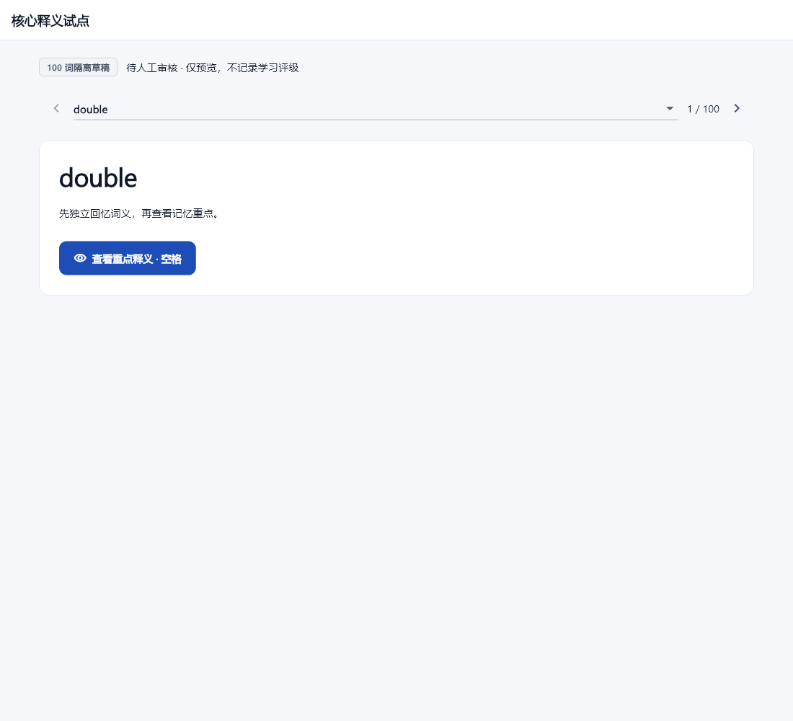
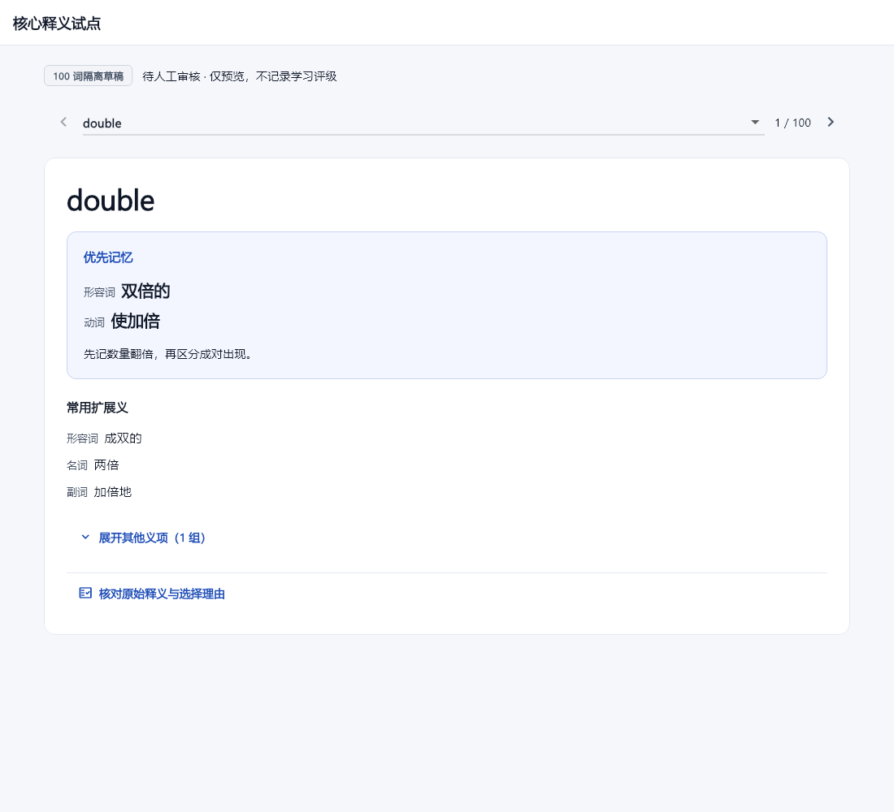

# P6-C 100 词核心释义隔离试点 v2

已完成100词逐词AI提炼、来源校验、问题台账和独立UI验证。**全部仍为待人工审核草稿，未接入正式学习界面，不能直接覆盖正式词库。**

- `selection.json` 从现有 5,332 词内容 CSV 选择 100 个不同稳定 ID：复杂词性、多义、高频、简单词和确定性随机样本各 20 个，组间互斥。
- `core_meanings_pilot.json` 保存三个层级、完整29字段输入快照、263个原文解释片段的字符位置、来源/决定哈希、逐词理由和待复核标记。
- `review_required` 必须保留；置信度只是试验自评，排序不是语料频率或官方考试重点证据。
- 正式 `meaning_zh`、稳定 ID、Notion 和个人 SQLite 均不由这两个脚本修改。试验中没有新增正式词义。

阅读 [完整报告](../P6C_CORE_MEANINGS_PILOT_REPORT.md)、[100词人工复核工作表](REVIEW_WORKSHEET.md) 和 [提示词v2](PROMPT_V2.md)。48词为高风险复核对象；`human_review.json` 中100词均为pending，AI没有代签。

`scripts/p6c/semantic_decisions.py` 是本会话逐词AI决定；`build_core_pilot.py` 只重放这些决定并装配来源，不会调用模型生成新词。

```powershell
& 'C:/Users/admin/AppData/Local/Programs/Python/Python314/python.exe' -X utf8 scripts/p6c/build_core_pilot.py --check
& 'C:/Users/admin/AppData/Local/Programs/Python/Python314/python.exe' -X utf8 scripts/p6c/validate_pilot.py
flutter run --no-pub -d windows -t lib/p6c_pilot_main.dart --dart-define=P6C_ENABLE_PILOT=true --dart-define=P6C_PILOT_FILE=D:/Desktop/EnglishLearning/docs/p6/p6c/core_meanings_pilot.json
```

上述UI使用单独入口，仅从指定JSON读取样本，不打开个人SQLite、不加载凭据或Notion服务。默认正式入口、路由、pubspec资源表均未接入草稿。

`--init-review` 只能创建不存在的台账，不能覆盖既有人工记录。来源或决定变更会使旧审核绑定失效，校验失败时应先复核，不能自动抹掉旧审批。`collect_reference_evidence.py` 是显式的联网取证工具，普通装配与验证不联网；定价、词典证据更新后应作为新审阅版本处理。

截图为 Flutter widget 渲染证据，不是桌面真人点击验收，也不是内容审核：




